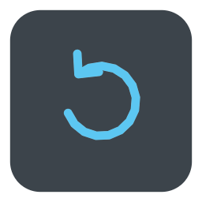
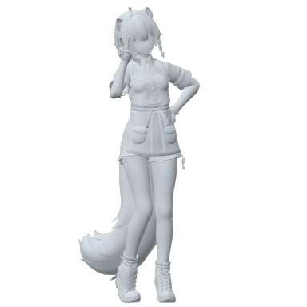

# VRChat での使い方

## メニュー

```
KTBポーズ（ポーズ集のメニュー名）
├ 通常に戻す
├ 設定
│ ├ 左右反転
│ └ 位置固定
└ ポーズ集のサブメニューとポーズ
```

| 項目 | アイコン | 内容 |
|---|---|---|
| 通常に戻す | { .menu-icon } | ポーズをやめて、ふだんの姿勢に戻ります |
| 設定 | { .menu-icon } | 左右反転と位置固定 |
| 左右反転 | { .menu-icon } | ポーズを左右反転します |
| 位置固定 | { .menu-icon } | ポーズ中に動かないようにします |

ポーズのアイコンは、導入したときのアバターの姿で作られます。サブメニューのアイコンは、中の最初のポーズの画像です。

## ポーズをとる・やめる

- ポーズを押すと、0.25 秒かけてそのポーズになります
- 別のポーズを押すと、そのまま切り替わります
- 同じポーズをもう一度押すか、**通常に戻す** で元に戻ります

ポーズ中は、頭・手・腰・足・指を、アニメーションのとおりに動かします。歩き・走り・しゃがみなどの移動のモーションと、ハンドサインは出ません。
目（まばたき・視線）と口（リップシンク）、表情はそのまま動きます。

!!! note "VR・フルトラッキングのとき"
    ポーズ中は、ヘッドセット・コントローラー・トラッカーの動きがアバターに伝わりません。ポーズをやめると、元のトラッキングに戻ります。

## 左右反転 { #mirror }

**設定 → 左右反転** を ON にすると、すべてのポーズが左右反転します。ほかの人からも反転して見えます。

<div class="mirror-demo" markdown>
<figure markdown="span">
  
  <figcaption>OFF</figcaption>
</figure>
<figure markdown="span">
  { .flip }
  <figcaption>ON</figcaption>
</figure>
</div>

設定は保存されるので、次にアバターを読み込んだときもそのままです。

## 位置固定 { #lock }

**設定 → 位置固定** を ON にすると、ポーズ中は移動の操作をしても動かなくなります。ポーズをやめると、また動けます。

| | ポーズ中に移動の操作をすると |
|---|---|
| OFF | ポーズのまま、滑るように動きます |
| ON（デスクトップ） | 移動と、左右の向き変えができなくなります。上下を見ることはできます |
| ON（VR） | コントローラーでの移動と回転ができなくなります。部屋の中を歩いた分は動きます |

自分の動きにだけ関係する設定なので、同期はしていません（同期パラメーターを使いません）。設定は保存されます。

## 座っているとき

椅子などに座っている（ステーションに入っている）あいだは、ポーズをとりません。
選んでいる途中で座ると、ポーズをやめます。立ち上がると、選んでいるポーズに戻ります。

## すわるポーズ

「すわる」のポーズ（しゃがみ頬杖・体育座り・女の子座り）は、アバターの見た目だけが床に座ります。当たり判定は立っているときのままです。

## アバターを読み込んだとき

ポーズは保存されないので、アバターを読み込んだときはいつも通常の状態です。左右反転と位置固定の設定は保存されます。

## ほかの人からの見え方

選んでいるポーズと左右反転は同期するので、ほかの人からも同じポーズに見えます。

## エモートとの関係

ポーズは、アバターのエモートと同じ Action レイヤーで再生します。ポーズ中はポーズが優先されます。
ポーズをとっていないときは、エモートや AFK のモーションのじゃまをしません。
