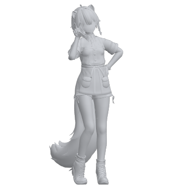
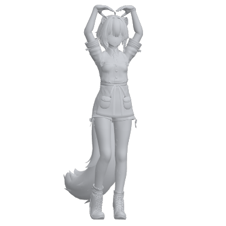
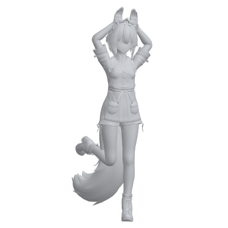
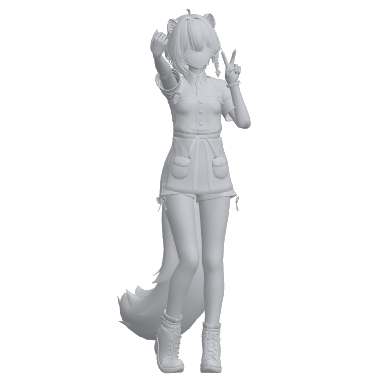
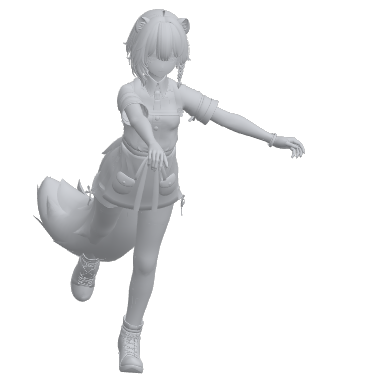
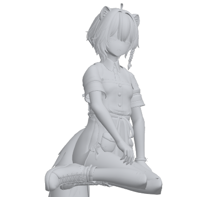

# KTBPoses

KTBPoses は、VRChat のアバターにポーズ集を入れるための Unity のツールです。ポーズのアニメーションを集めて Expression Menu を組み立て、ボタン 1 つでアバターに導入できます。VRChat の中でメニューからポーズを選ぶと、全身がそのポーズになります。

## できること

-   :material-human-handsup:{ .lg .middle } **100 種類のポーズを同梱**

    ---

    横ピース、指ハート、うさみみ、自撮り、アラベスク、正座など。6 つのカテゴリに分かれた、入れてすぐに使えるポーズ集が付いています。

    [:octicons-arrow-right-24: 同梱のポーズ](poses.md)

-   :material-file-tree:{ .lg .middle } **メニューを自由に組める**

    ---

    サブメニューの作成・並べ替え・名前の変更を、ドラッグ＆ドロップで。ポーズ集はいくつでも作れます。

    [:octicons-arrow-right-24: ポーズ集を作る](pose-sets.md)

-   :material-tag-multiple:{ .lg .middle } **手持ちのアニメーションも使える**

    ---

    クリップやフォルダを選ぶだけでライブラリに追加。名前とタグで整理して、検索で探せます。

    [:octicons-arrow-right-24: アニメーションを追加する](library.md)

-   :material-shield-check:{ .lg .middle } **アバターを書き換えない**

    ---

    Modular Avatar で組み込むので、アバター本体はそのまま。取り外しもボタン 1 つです。

    [:octicons-arrow-right-24: アバターに導入する](install-avatar.md)

-   :material-counter:{ .lg .middle } **同期パラメーターは 9 bit**

    ---

    ポーズがいくつあっても 9 bit。導入する前に、アバター全体の使用量と、入るかどうかを確かめられます。

    [:octicons-arrow-right-24: パラメーター](parameters.md)

-   :material-swap-horizontal:{ .lg .middle } **左右反転と位置固定**

    ---

    メニューの「設定」から、ポーズを左右反転したり、ポーズ中に動かないようにしたりできます。

    [:octicons-arrow-right-24: VRChat での使い方](in-vrchat.md)

## はじめる

1. [インストール](install.md)：Unity のプロジェクトに KTBPoses を入れます
2. [はじめかた](quickstart.md)：同梱のポーズ集をアバターに入れて、VRChat で使うまで
3. 自分好みにする：[ポーズ集を作る](pose-sets.md)、[アニメーションを追加する](library.md)

!!! note "このマニュアルについて"
    KTBPoses 2.1 に対応しています。ポーズの画像は、ポーズの形が分かりやすいように、形と陰影だけで表示しています。
