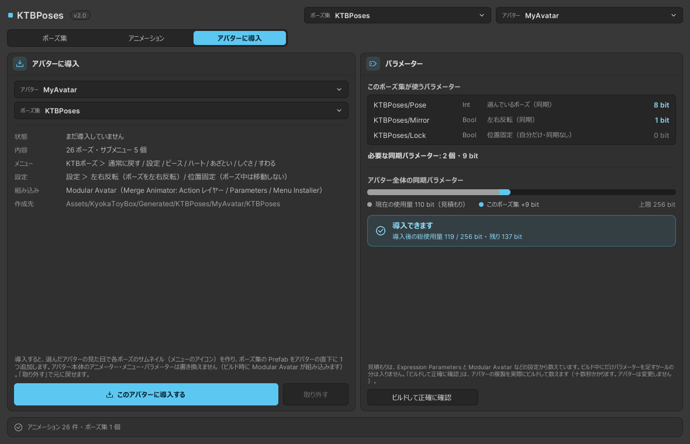
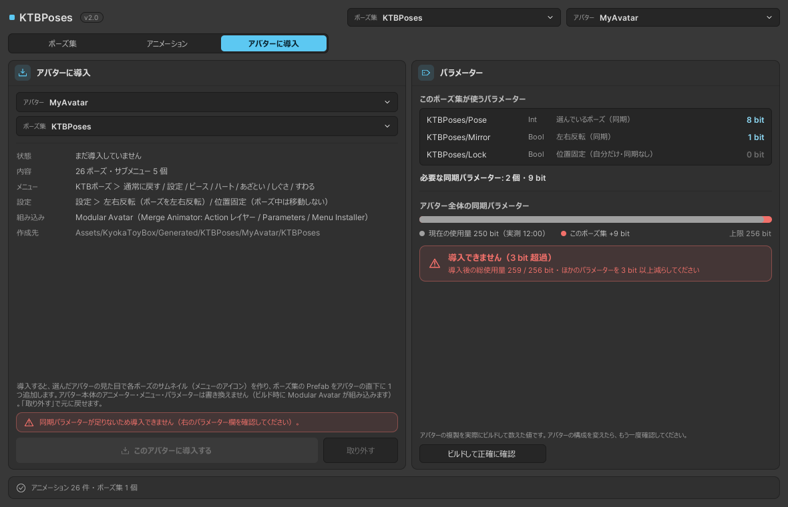

# アバターに導入する

選んだポーズ集を、選んだアバターに入れます。

{ .screenshot }

## 導入する

アバターとポーズ集を選び、**このアバターに導入する** を押します。

1. 選んだアバターの姿で、各ポーズのサムネイル（Expression Menu のアイコン）を作ります
2. ポーズ集のアニメーターと Prefab を作ります
3. Prefab（`KTBPoses`）を、アバターの直下に 1 つ追加します

アバター本体のアニメーター・メニュー・パラメーターは書き換えません。アップロードのときに Modular Avatar が組み込みます。

作ったものは `Assets/KyokaToyBox/Generated/KTBPoses/<アバター名>/<ポーズ集名>/` に入ります。

| ファイル | 内容 |
|---|---|
| `<ポーズ集名>.prefab` | アバターに置くもの（MA Merge Animator・MA Parameters・MA Menu Installer・MA Menu Item） |
| `KTBPoses.controller` | ポーズを再生するアニメーター |
| `Icons/` | メニューのアイコン（256 px） |

### 導入できないとき

次のときは、理由が赤い枠で表示され、導入のボタンが押せません。

- アバターが Humanoid でない
- ポーズ集にポーズが入っていない、またはポーズが 255 個を超えている
- 同期パラメーターが足りない（[同期パラメーターの確認](#parameters)）
- Play モード中

アニメーションが見つからない項目（ライブラリから外したものなど）があるときは、その項目を飛ばして導入します。

## 導入し直す { #reinstall }

導入済みのポーズ集を選んでいると、ボタンが **導入し直す** になります。
ポーズ集を編集したあとや、KTBPoses を更新したあとに押すと、アイコン・アニメーター・メニューを作り直します。アバターに置いた Prefab は、そのまま新しい内容になります。

## 別のポーズ集に置き換える

1 つのアバターに入れられるポーズ集は 1 つです。別のポーズ集を導入すると、確かめたあとで置き換えます。

## 取り外す { #uninstall }

**取り外す** で、アバターから KTBPoses を外します（元に戻す ++ctrl+z++ で戻せます）。
作ったアイコンや Prefab のアセットは残ります。いらなければ `Assets/KyokaToyBox/Generated/KTBPoses/<アバター名>` を消してください。

## 同期パラメーターの確認 { #parameters }

右の「パラメーター」に、ポーズ集が使う同期パラメーターと、アバター全体の使用量を表示します。

- **このポーズ集が使うパラメーター**：2 個・9 bit（ポーズの数によらず一定）。中身は [パラメーター](parameters.md) を見てください
- **アバター全体の同期パラメーター**：今の使用量、導入後の合計、上限（256 bit）
- **導入できます／導入できません**：導入後の合計が上限を超えるときは「導入できません（○ bit 超過）」と表示され、導入のボタンが押せなくなります

{ .screenshot }

足りないときは、ほかのギミックの同期パラメーターを、表示された bit 数だけ減らしてください。

### 見積もりと実測

| | 内容 |
|---|---|
| 見積もり | すぐに出る値です。Expression Parameters と、Modular Avatar などのコンポーネントの設定から数えます。アップロードのときにだけパラメーターを足すツールの分は入りません |
| 実測 | **ビルドして正確に確認** を押すと、アバターの複製を実際にビルドして数えます。十数秒かかります。シーンのアバターは変えません |

上限に近いときは、実測で確かめてください。
導入済みの KTBPoses の分は「今の使用量」に含めずに数えます（導入し直しても二重には数えません）。
