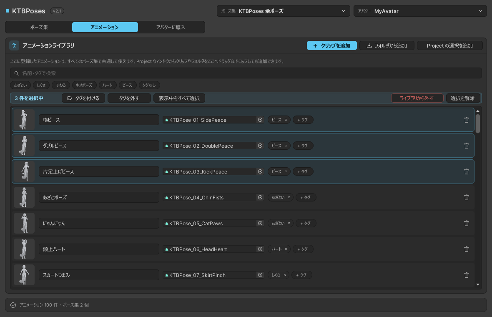

# アニメーションを追加する

ポーズに使うアニメーションを登録しておく場所が **アニメーションライブラリ** です。ライブラリは、このプロジェクトの **すべてのポーズ集で共通** です（`Assets/KyokaToyBox/KTBPosesData/KTBPoseLibrary.asset`）。

{ .screenshot }

## 追加する

| 方法 | 内容 |
|---|---|
| クリップを追加 | アニメーションクリップ（`.anim`）かモデル（`.fbx`）を 1 つ選びます。モデルのときは、中のクリップをすべて追加します |
| フォルダから追加 | フォルダを選ぶと、その下（サブフォルダを含む）のクリップをまとめて追加します |
| Project の選択を追加 | Project ウィンドウで選んでいるクリップ・フォルダ・モデルを追加します |
| ドラッグ＆ドロップ | Project ウィンドウから、クリップ・フォルダ・モデルをこのタブに落とします |

- 選べるのは、このプロジェクトの中（`Assets` か `Packages` の下）にあるファイルだけです
- ライブラリに入るのは、クリップへの参照です。ファイルを複製したり移動したりはしません
- もう入っているクリップは、二重には入りません
- 追加した項目は選ばれた状態になるので、そのまま [まとめてタグを付けられます](#bulk)

## 使えるアニメーション

**Humanoid** のアニメーションクリップを使ってください。Humanoid のクリップなら、どのアバターでも同じポーズになります。

- Humanoid でないクリップには「Humanoid ではありません」と表示されます。そのクリップを作ったアバター以外では、同じポーズになりません
- 止まったポーズを想定しています。動きのあるクリップは、ポーズ中にクリップのとおり再生されます（くり返すかどうかもクリップの設定のとおり）

## 名前を変える { #rename }

一覧の名前の欄で変えられます。この名前がメニューに出ます（[ポーズ集の側で名前を付けた](pose-sets.md#rename) ときは、そちらが優先されます）。空にするとクリップの名前を使います。クリップのファイル名は変わりません。

## タグ

タグでポーズを分類しておけます。同梱のポーズには、カテゴリ名（ピース・ハート・あざとい・しぐさ・キメポーズ・すわる）のタグが付いています。

- **＋ タグ** でタグを付けます。今あるタグから選ぶか、「新しいタグ…」で作ります
- タグの **×** で外します

### まとめて操作する { #bulk }

行をクリックすると選べます。++ctrl++ を押しながらクリックで 1 つずつ足し、++shift++ を押しながらクリックで範囲をまとめて選べます。

選ぶと上に帯が出て、選んだ項目にまとめて **タグを付ける**・**タグを外す**・**ライブラリから外す** ができます。**表示中をすべて選択** で、絞り込んでいる項目をすべて選べます。

## 探す・絞り込む { #filter }

- 検索欄：名前・クリップのファイル名・タグで探します。スペースで区切ると、すべてを含むものに絞ります
- タグのボタン：押したタグを **すべて** 持つものに絞ります。**タグなし** で、タグの無いものだけに
- **× クリア** で絞り込みをやめます

絞り込みは、[ポーズ集](pose-sets.md) タブの右の一覧にも同じように効きます。

## クリップを差し替える

一覧のクリップの欄に、別のクリップを入れられます。そのポーズを使っているポーズ集すべてに反映されます（導入済みのアバターは、導入し直すと変わります）。

## ライブラリから外す

行の右のゴミ箱のボタンで外します（複数選んでいるときは、選んだものすべて）。

- クリップのファイルは消しません
- そのアニメーションを使っているポーズ集があれば、確認のときに一覧が出ます。外すと、そのポーズ集のメニューからも外れます

## 同梱ポーズを体型に合わせ直す { #refit }

同梱の 100 ポーズは、手の位置や足の接地を、制作に使ったアバターの体型に合わせて作ってあります。体型や衣装が大きく違うアバターでは、手が顔に少しめり込んだり、腕が体に埋まったり、足が少し浮いたり沈んだりすることがあります。

上の段でアバターを選び、何も選んでいないときに出る **同梱ポーズを体型に合わせ直す** を押すと、そのアバターの体型と衣装に合わせて計算し直します（1 分ほどかかります）。

- 手の位置、腕が体や服や床にめり込まない角度、足と床の接地（すわるポーズでは、お尻やひざと床の接地）を、そのアバターで計算します
- 同梱ポーズのアニメーション（`Assets/KyokaToyBox/KTBPoses/Animations`）を上書きします。同じアニメーションを使う、ほかのアバターのポーズも変わります
- 導入済みのアバターのポーズにもすぐ反映されます。メニューのアイコンは、[導入し直す](install-avatar.md#reinstall) と新しいポーズになります

!!! tip "元に戻すには"
    KTBPoses を [入れ直す](install.md#update) と、同梱ポーズのアニメーションが元に戻ります。
