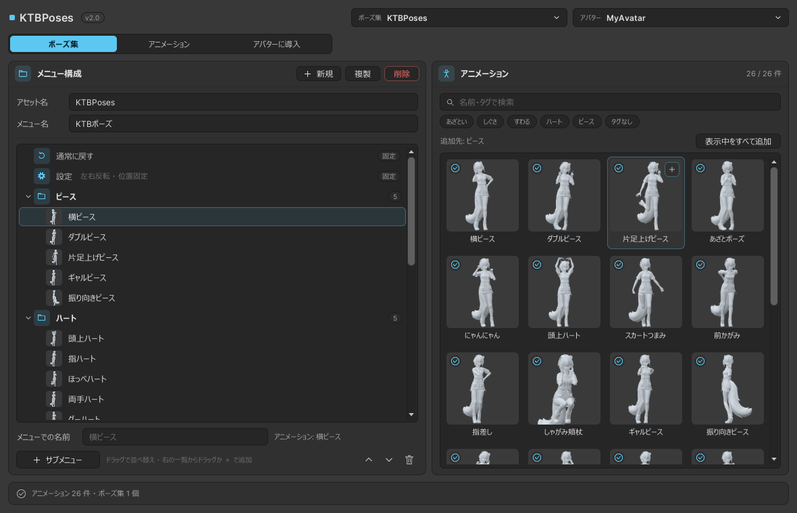

# ポーズ集を作る

ポーズ集は、Expression Menu の 1 つのまとまりです。どのポーズを、どのサブメニューに、どの順番で並べるかを決めます。
1 つのポーズ集が 1 つのアセット（`Assets/KyokaToyBox/KTBPosesData/Sets/`）になり、いくつでも作れます。

{ .screenshot }

## 作る・複製する・削除する

「メニュー構成」の右上のボタンで操作します。

| ボタン | 内容 |
|---|---|
| 新規 | 空のポーズ集を作ります |
| 複製 | 今のポーズ集をコピーします。少しだけ変えた版を作るときに |
| 削除 | ポーズ集のアセットを消します（パソコンのゴミ箱に移動します）。アバターに導入済みのものと、ライブラリのアニメーションは残ります |

上の段の「ポーズ集」でも、ポーズ集の切り替えと「新しいポーズ集を作る」ができます。

## 名前

| 項目 | 内容 |
|---|---|
| アセット名 | アセットのファイル名です。++enter++ を押すか、欄から出たときに変わります |
| メニュー名 | Expression Menu に出る名前です。空にするとアセット名を使います |

## メニュー構成

左の一覧が、そのまま Expression Menu になります。

### 固定の項目

一番上の **通常に戻す** と **設定**（左右反転・位置固定）は、どのポーズ集にも必ず入ります。動かしたり外したりはできません。

### ポーズを入れる

右の「アニメーション」からポーズを入れます。

- タイルを左の一覧へ **ドラッグ** する（入れたい位置に落とせます）
- タイルにマウスを乗せると出る **＋** を押すか、タイルを **ダブルクリック** する
- **表示中をすべて追加** で、検索やタグで絞り込んだものをまとめて入れる

＋ とダブルクリックでは、一覧の上の「追加先」に入ります。
追加先は、左で選んでいるサブメニューです（ポーズを選んでいるときは、そのポーズと同じサブメニュー）。何も選んでいなければ一番上の階層に入ります。

このポーズ集にもう入っているポーズは、タイルの左上に :material-check-circle-outline: が付きます。同じポーズを、別のサブメニューにも入れられます。

右の一覧の検索とタグの使い方は、[探す・絞り込む](library.md#filter) と同じです。

### サブメニューを作る

- **＋ サブメニュー**：選んでいる項目と同じ階層に、新しいサブメニューを作ります（何も選んでいなければ一番上の階層の最後）
- サブメニューを右クリック → **この中にサブメニューを追加**：サブメニューの中にサブメニューを作ります

作ったら、下の欄で名前を付けます。

### 並べ替える・移動する

- 項目を **ドラッグ** して、ほかの項目の上か下に落とすと並べ替わります。サブメニューの真ん中に落とすと、その中へ移動します
- 下の **∧ ∨** で、同じ階層の中を 1 つずつ動かせます

サブメニューは、左の ▸ を押すかダブルクリックで開閉します。

### 名前を変える { #rename }

項目を選ぶと、下の欄で名前を変えられます。

ポーズの名前を空にすると、[ライブラリでの名前](library.md#rename) がそのまま出ます。ポーズ集の側で付けた名前は、そのポーズ集のメニューだけに出ます。

### 外す

項目を選んでゴミ箱のボタンを押すか、右クリック → **メニューから外す**。
サブメニューを外すと、中の項目もまとめて外れます。アニメーションはライブラリに残ります。

!!! note "1 ページに入るのは 8 個まで"
    Expression Menu の 1 ページに入るのは 8 個までです。超えると、Modular Avatar が 7 個目のあとに「More」というサブメニューを作り、残りをそこに入れます。
    8 個を超えたサブメニューには :material-alert: が付きます。一番上の階層は、通常に戻す・設定を含めて数えます。

## 導入済みのアバターに反映する

ポーズ集を変えたら、[アバターに導入](install-avatar.md) タブで [導入し直す](install-avatar.md#reinstall) を押してください。導入し直すまで、アバターのメニューは前のままです。
