# 同梱のポーズ

KTBPoses には、100 種類のポーズが入っています。最初に開いたときにライブラリに登録され、6 つのサブメニュー（ピース・ハート・あざとい・しぐさ・キメポーズ・すわる）に分けたポーズ集「KTBPoses」になります。2.0 から更新したときは、増えた 74 ポーズがライブラリに追加されます（[更新するとき](install.md#update)）。

写真でよく見る全身のポーズ、プリクラや SNS でよく使われているポーズ、ふだんのしぐさ、バレエ・チアリーディング・ヨガでおなじみのポーズなどです。どのポーズも、このツールのために一から作りました。ほかのポーズ集やモーションのデータは使っていません。

!!! note "画像について"
    ポーズの形が分かりやすいように、形と陰影だけで表示しています。手の位置や足の接地は、制作に使ったアバターの体型に合わせてあります。体型が大きく違うアバターでは、[同梱ポーズを体型に合わせ直す](library.md#refit) で合わせられます。

## ポーズの位置 { #position }

どのポーズも、体全体の重心（頭・胴・腕・脚の重さを考えた体の中心）が、左右方向でアバターの視点の真上に来るように置いています。片足に重心をかけるポーズや、足を横に流して座るポーズ、寝転ぶポーズでも、アバターがプレイヤーの横にずれません（2.1.2 から）。前後と高さは、足やお尻が床に付く位置です。

## ピース

<figure markdown="span">
  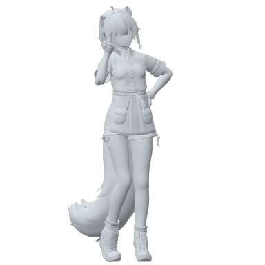
  <figcaption><strong>横ピース</strong>右手で目の横にピース、左手は腰。左足に重心、右足はつま先立ち</figcaption>
</figure>
<figure markdown="span">
  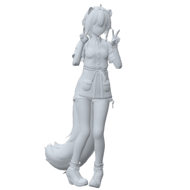
  <figcaption><strong>ダブルピース</strong>両手のピースを頬の横に。内股</figcaption>
</figure>
<figure markdown="span">
  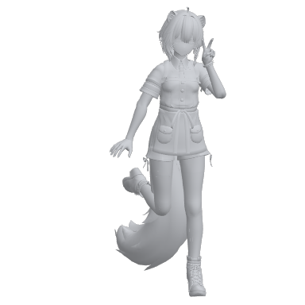
  <figcaption><strong>片足上げピース</strong>右足を後ろに跳ね上げ、左手で目の横にピース。右手は横でバランス</figcaption>
</figure>
<figure markdown="span">
  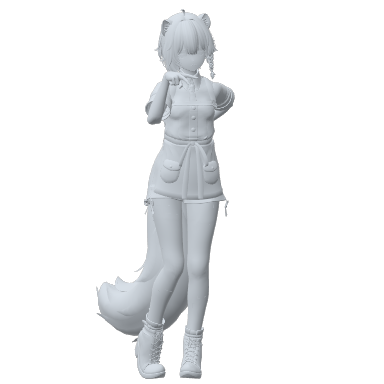
  <figcaption><strong>ギャルピース</strong>裏返したピースをあごの前に突き出す。左手は後ろ</figcaption>
</figure>
<figure markdown="span">
  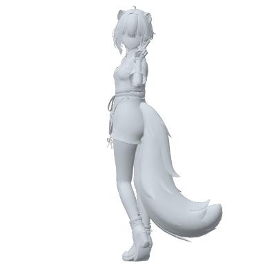
  <figcaption><strong>振り向きピース</strong>背中を向けて肩越しに振り向き、顔の横でピース</figcaption>
</figure>
<figure markdown="span">
  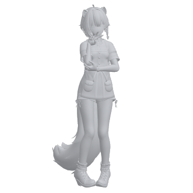
  <figcaption><strong>あごピース</strong>あごに添えてピース。もう片方の手でひじを支える</figcaption>
</figure>
<figure markdown="span">
  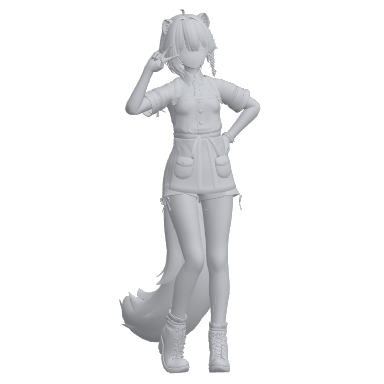
  <figcaption><strong>目元ピース</strong>横にしたピースを目元に。左手は腰</figcaption>
</figure>
<figure markdown="span">
  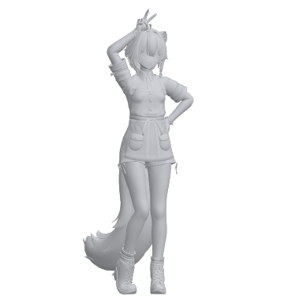
  <figcaption><strong>頭ピース</strong>頭の上にピースを立てる。左手は腰</figcaption>
</figure>
<figure markdown="span">
  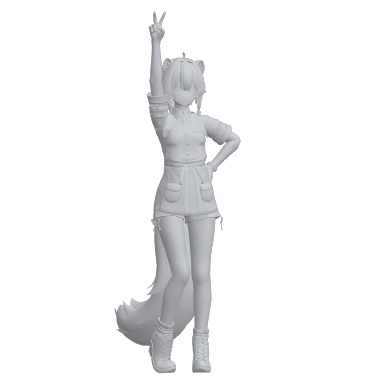
  <figcaption><strong>片手上げピース</strong>右手を高く上げてピース。左手は腰</figcaption>
</figure>
<figure markdown="span">
  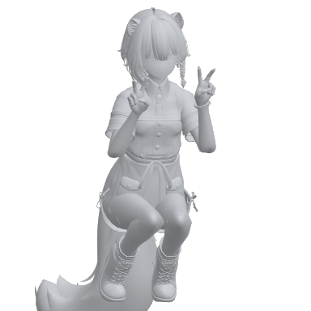
  <figcaption><strong>しゃがみピース</strong>つま先でしゃがんで、両手でピース</figcaption>
</figure>
<figure markdown="span">
  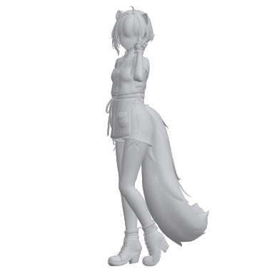
  <figcaption><strong>横向きピース</strong>体を横に向けて顔はカメラへ。顔の横でピース</figcaption>
</figure>
<figure markdown="span">
  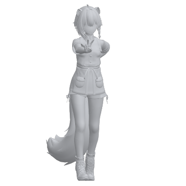
  <figcaption><strong>前ピース</strong>ピースをカメラに向けて前に出す。少し前のめり</figcaption>
</figure>
<figure markdown="span">
  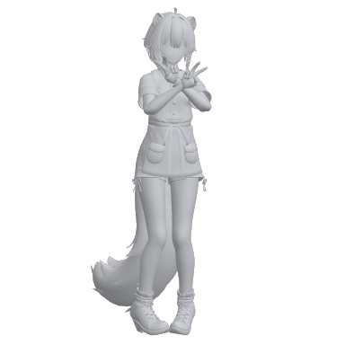
  <figcaption><strong>クロスピース</strong>両手のピースをあごの前で交差させる</figcaption>
</figure>

## ハート

<figure markdown="span">
  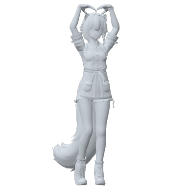
  <figcaption><strong>頭上ハート</strong>両腕で頭の上に大きなハート</figcaption>
</figure>
<figure markdown="span">
  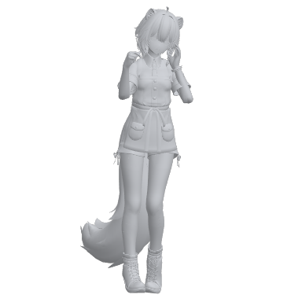
  <figcaption><strong>指ハート</strong>親指と人差し指の小さなハートを前に。左手は頬に</figcaption>
</figure>
<figure markdown="span">
  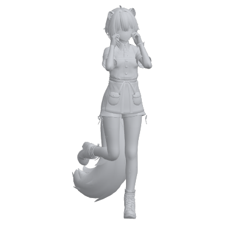
  <figcaption><strong>ほっぺハート</strong>両手の半分ハートを頬に添えて、顔をハートで囲む。片足を後ろに上げる</figcaption>
</figure>
<figure markdown="span">
  
  <figcaption><strong>両手ハート</strong>胸の前で両手のハート。内股</figcaption>
</figure>
<figure markdown="span">
  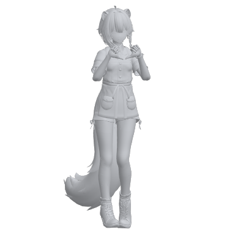
  <figcaption><strong>グーハート</strong>グーの親指を下に向けて合わせるハート</figcaption>
</figure>
<figure markdown="span">
  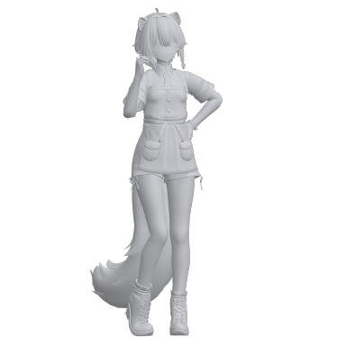
  <figcaption><strong>片手ハート</strong>片手で半分のハートを作って顔の横に。左手は腰</figcaption>
</figure>
<figure markdown="span">
  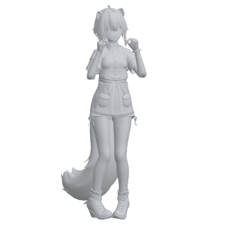
  <figcaption><strong>両手で指ハート</strong>両手の指ハートを頬の横に</figcaption>
</figure>
<figure markdown="span">
  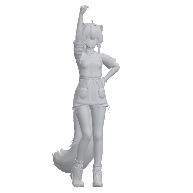
  <figcaption><strong>頭上指ハート</strong>指ハートを頭の上に掲げる。左手は腰</figcaption>
</figure>
<figure markdown="span">
  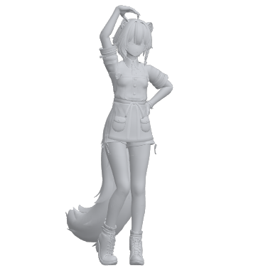
  <figcaption><strong>片腕ハート</strong>右腕を頭の上で丸めて、大きなハートの半分に。左手は腰</figcaption>
</figure>
<figure markdown="span">
  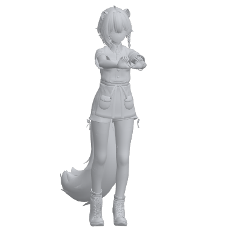
  <figcaption><strong>ハートを差し出す</strong>両手のハートを前に差し出す。少し前のめり</figcaption>
</figure>
<figure markdown="span">
  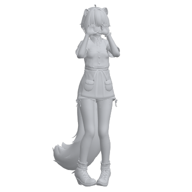
  <figcaption><strong>ハートのぞき</strong>両手のハートを目の前に作ってのぞく</figcaption>
</figure>
<figure markdown="span">
  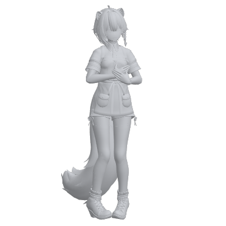
  <figcaption><strong>胸きゅん</strong>両手を胸に当てて、肩をすくめる</figcaption>
</figure>
<figure markdown="span">
  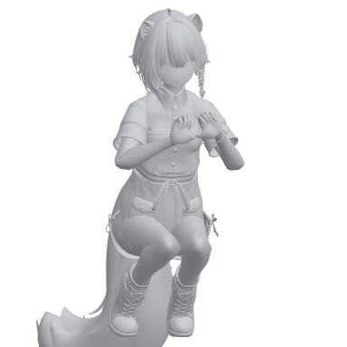
  <figcaption><strong>しゃがみハート</strong>つま先でしゃがんで、両手のハート</figcaption>
</figure>

## あざとい

<figure markdown="span">
  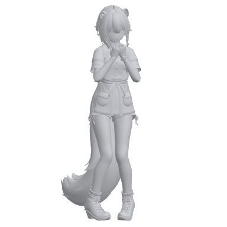
  <figcaption><strong>あざとポーズ</strong>両手のグーをあごの下に。内股で少し前のめり</figcaption>
</figure>
<figure markdown="span">
  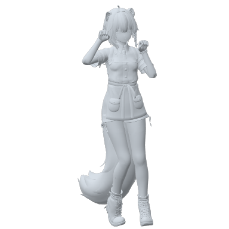
  <figcaption><strong>にゃんにゃん</strong>猫の手（右は耳の横、左は頬の横）。体を少しくねらせる</figcaption>
</figure>
<figure markdown="span">
  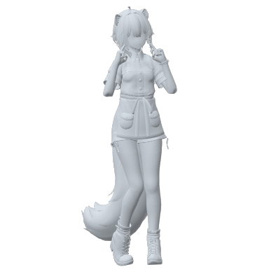
  <figcaption><strong>ほっぺツンツン</strong>両手の人差し指でほっぺをつつく。内股</figcaption>
</figure>
<figure markdown="span">
  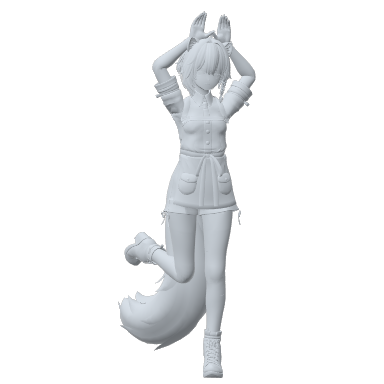
  <figcaption><strong>うさみみ</strong>頭の上に手のひらを立ててうさぎの耳。片足を後ろに上げる</figcaption>
</figure>
<figure markdown="span">
  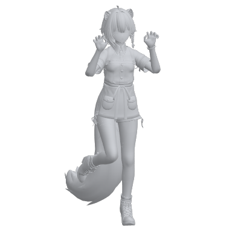
  <figcaption><strong>がおー</strong>顔の横で爪を立てた手。片ひざを上げる</figcaption>
</figure>
<figure markdown="span">
  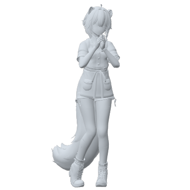
  <figcaption><strong>おねがい</strong>あごの下で手を合わせて上目づかい</figcaption>
</figure>
<figure markdown="span">
  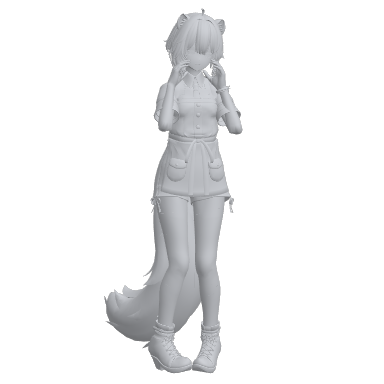
  <figcaption><strong>ほっぺ包み</strong>両手でほっぺを包む。内股</figcaption>
</figure>
<figure markdown="span">
  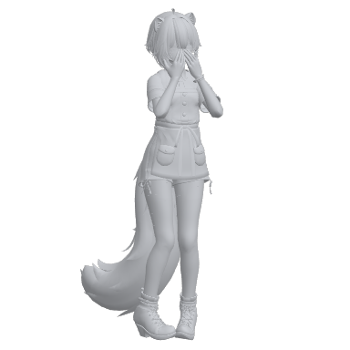
  <figcaption><strong>照れ</strong>両手で口元をかくして、少しうつむく</figcaption>
</figure>
<figure markdown="span">
  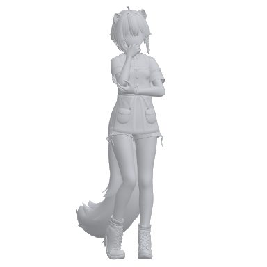
  <figcaption><strong>口元に手</strong>軽く握った手を口元に。もう片方の手でひじを支える</figcaption>
</figure>
<figure markdown="span">
  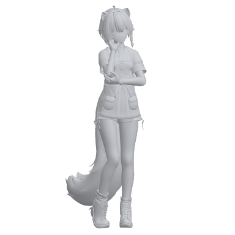
  <figcaption><strong>頬杖</strong>手のひらに頬をのせて首をかしげる</figcaption>
</figure>
<figure markdown="span">
  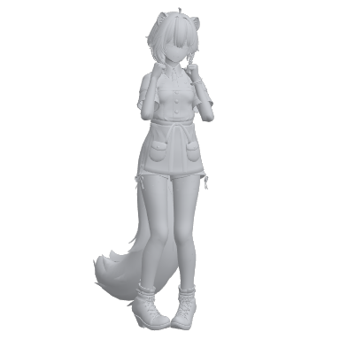
  <figcaption><strong>ほっぺグー</strong>両手のグーを頬に当てる</figcaption>
</figure>
<figure markdown="span">
  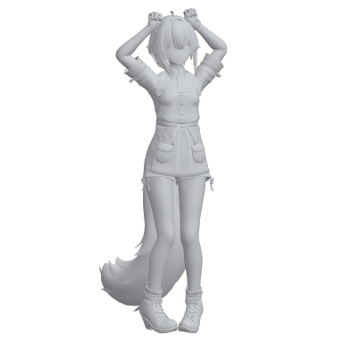
  <figcaption><strong>くまみみ</strong>頭の上に両手のグーをのせて、くまの耳</figcaption>
</figure>
<figure markdown="span">
  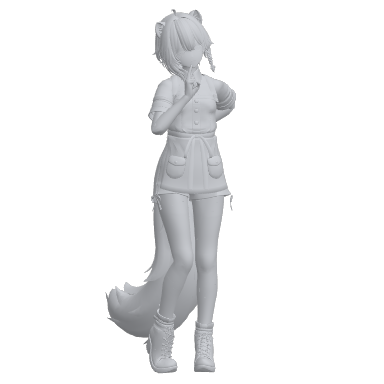
  <figcaption><strong>きょとん</strong>指先を口元に当てて首をかしげる。左手は後ろ</figcaption>
</figure>
<figure markdown="span">
  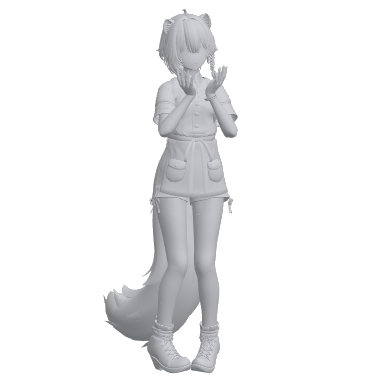
  <figcaption><strong>お花</strong>そろえた両手にあごをのせて、指を花びらのように広げる</figcaption>
</figure>
<figure markdown="span">
  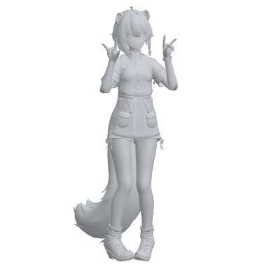
  <figcaption><strong>きつね</strong>両手のきつねを顔の横に</figcaption>
</figure>
<figure markdown="span">
  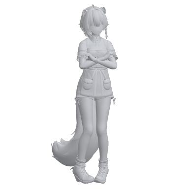
  <figcaption><strong>ぎゅー</strong>両腕を抱えて、自分をぎゅっと抱きしめる</figcaption>
</figure>
<figure markdown="span">
  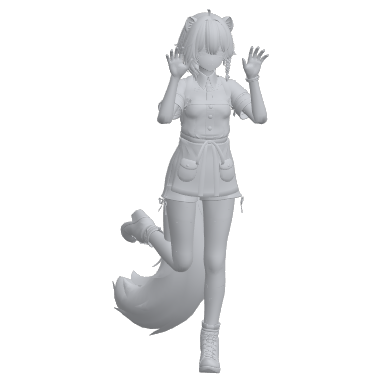
  <figcaption><strong>ばあ</strong>開いた両手を顔の横に出して前のめり。片足を後ろに上げる</figcaption>
</figure>
<figure markdown="span">
  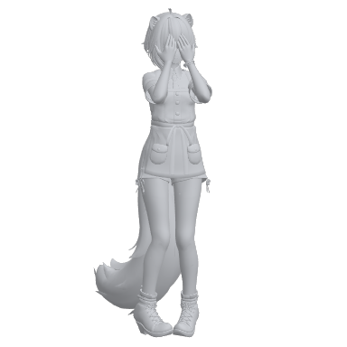
  <figcaption><strong>いないいない</strong>両手で目をかくす</figcaption>
</figure>
<figure markdown="span">
  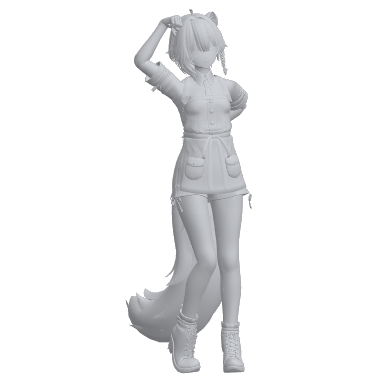
  <figcaption><strong>こつん</strong>グーで頭を軽くこつん。首をかしげる</figcaption>
</figure>

## しぐさ

<figure markdown="span">
  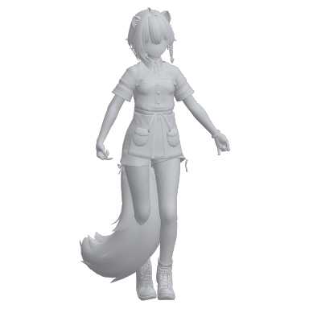
  <figcaption><strong>スカートつまみ</strong>両手で裾をつまんで広げ、右足を後ろに引くカーテシー</figcaption>
</figure>
<figure markdown="span">
  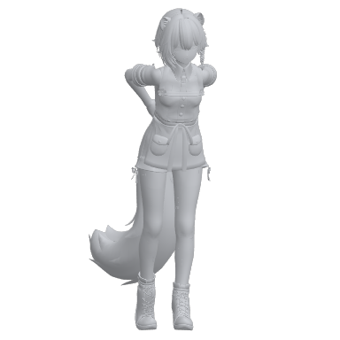
  <figcaption><strong>前かがみ</strong>手を後ろで組んで前かがみ、上目づかい</figcaption>
</figure>
<figure markdown="span">
  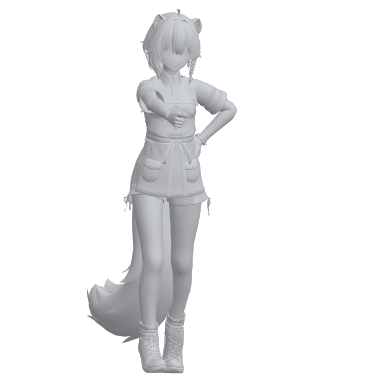
  <figcaption><strong>指差し</strong>カメラを指差し、左手は腰。前に踏み込む</figcaption>
</figure>
<figure markdown="span">
  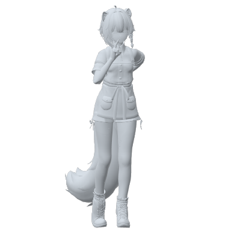
  <figcaption><strong>しーっ</strong>人差し指を口元に。左手は後ろ</figcaption>
</figure>
<figure markdown="span">
  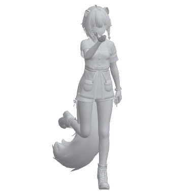
  <figcaption><strong>投げキッス</strong>口元から手のひらを前へ。片足を後ろに上げる</figcaption>
</figure>
<figure markdown="span">
  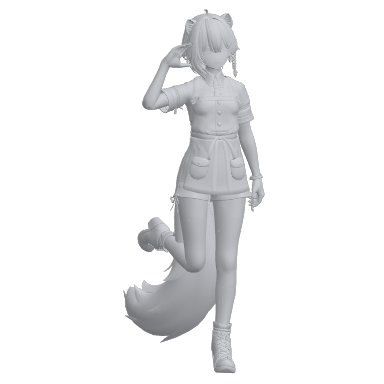
  <figcaption><strong>敬礼</strong>おでこの横で敬礼。かかとを上げる</figcaption>
</figure>
<figure markdown="span">
  
  <figcaption><strong>やったー</strong>両手を上げてバンザイ。片足を後ろに上げる</figcaption>
</figure>
<figure markdown="span">
  
  <figcaption><strong>バイバイ</strong>顔の横で手を振る</figcaption>
</figure>
<figure markdown="span">
  
  <figcaption><strong>グッド</strong>胸の前で親指を立てる。左手は腰</figcaption>
</figure>
<figure markdown="span">
  
  <figcaption><strong>OK</strong>頬の横で OK サイン。左手は腰</figcaption>
</figure>
<figure markdown="span">
  
  <figcaption><strong>考え中</strong>指をほっぺに当てて、もう片方の手でひじを支える</figcaption>
</figure>
<figure markdown="span">
  
  <figcaption><strong>腕組み</strong>腕を組んで、顔をそむける</figcaption>
</figure>
<figure markdown="span">
  
  <figcaption><strong>えっへん</strong>両手を腰に当てて胸を張る</figcaption>
</figure>
<figure markdown="span">
  
  <figcaption><strong>のび</strong>頭の上で手を組んで、つま先立ちでのびをする</figcaption>
</figure>
<figure markdown="span">
  
  <figcaption><strong>ひらめいた</strong>人差し指を頭の横に立てる。片足を後ろに上げる</figcaption>
</figure>
<figure markdown="span">
  
  <figcaption><strong>ファイト</strong>胸の前で両手のグー</figcaption>
</figure>
<figure markdown="span">
  
  <figcaption><strong>おいで</strong>手のひらを上にして手招き。左手は後ろ</figcaption>
</figure>
<figure markdown="span">
  
  <figcaption><strong>おーい</strong>両手を口に添えて呼びかける</figcaption>
</figure>
<figure markdown="span">
  
  <figcaption><strong>ぺこり</strong>手を前でそろえておじぎ</figcaption>
</figure>
<figure markdown="span">
  
  <figcaption><strong>もしもし</strong>親指と小指を立てた電話の手を耳に</figcaption>
</figure>
<figure markdown="span">
  
  <figcaption><strong>自撮り</strong>スマホを持つように片手を前へ伸ばし、もう片方の手でピース</figcaption>
</figure>
<figure markdown="span">
  
  <figcaption><strong>指カメラ</strong>両手の L の指先を合わせて、目の前に長方形の枠を作る</figcaption>
</figure>
<figure markdown="span">
  
  <figcaption><strong>わかんない</strong>手のひらを上にして肩をすくめる</figcaption>
</figure>
<figure markdown="span">
  
  <figcaption><strong>はーい</strong>右手をまっすぐ上げる。片足を後ろに上げる</figcaption>
</figure>
<figure markdown="span">
  
  <figcaption><strong>ようこそ</strong>両手を腰の高さで広げる。手のひらは上</figcaption>
</figure>

## キメポーズ

<figure markdown="span">
  
  <figcaption><strong>モデル立ち</strong>右手を腰に当て、左ひざを内側に入れて立つ</figcaption>
</figure>
<figure markdown="span">
  
  <figcaption><strong>足クロス</strong>足を前で交差させて、手は後ろで組む</figcaption>
</figure>
<figure markdown="span">
  
  <figcaption><strong>髪かき上げ</strong>右手で横の髪をかき上げる。左手は腰</figcaption>
</figure>
<figure markdown="span">
  
  <figcaption><strong>横向き</strong>体を横に向けて手を前で組み、顔だけカメラへ</figcaption>
</figure>
<figure markdown="span">
  
  <figcaption><strong>後ろ姿</strong>背中を向けて手を後ろで組み、横を向く</figcaption>
</figure>
<figure markdown="span">
  
  <figcaption><strong>いちばん</strong>人差し指を高く上げる。左手は腰</figcaption>
</figure>
<figure markdown="span">
  
  <figcaption><strong>バーン</strong>指鉄砲をカメラに向ける。左手は腰</figcaption>
</figure>
<figure markdown="span">
  
  <figcaption><strong>ひざに手</strong>ひざを曲げて手をひざにのせ、軽く前かがみで上目づかい</figcaption>
</figure>
<figure markdown="span">
  
  <figcaption><strong>スキップ</strong>つま先立ちで片ひざを上げ、腕を振る</figcaption>
</figure>
<figure markdown="span">
  
  <figcaption><strong>くるっ</strong>回るように両腕を広げ、片足を後ろへ</figcaption>
</figure>
<figure markdown="span">
  
  <figcaption><strong>アラベスク</strong>バレエのアラベスク。片足を後ろへ伸ばし、腕は前と横へ</figcaption>
</figure>
<figure markdown="span">
  
  <figcaption><strong>パッセ</strong>バレエのパッセ。片足のつま先をひざに当て、両腕を頭の上で丸める</figcaption>
</figure>
<figure markdown="span">
  
  <figcaption><strong>チアV</strong>チアの「ハイ V」。両手のグーを V の字に上げる</figcaption>
</figure>
<figure markdown="span">
  
  <figcaption><strong>チアななめ</strong>チアの「ダイアゴナル」。腕を斜め上と斜め下に一直線</figcaption>
</figure>
<figure markdown="span">
  
  <figcaption><strong>木のポーズ</strong>ヨガの木のポーズ。片足の裏を太ももに当て、頭の上で手を合わせる</figcaption>
</figure>
<figure markdown="span">
  
  <figcaption><strong>戦士のポーズ</strong>ヨガの戦士のポーズ（II）。足を大きく開いてひざを曲げ、両腕を横に伸ばす</figcaption>
</figure>
<figure markdown="span">
  
  <figcaption><strong>ダンサーのポーズ</strong>ヨガのダンサーのポーズ。後ろに上げた足を手で持ち、もう片腕を前へ</figcaption>
</figure>

## すわる

「すわる」のポーズは、アバターの見た目だけが床に座ったり寝転んだりします。当たり判定は立っているときのままです。

<figure markdown="span">
  
  <figcaption><strong>しゃがみ頬杖</strong>つま先でしゃがみ、両手でほっぺを包む</figcaption>
</figure>
<figure markdown="span">
  
  <figcaption><strong>体育座り</strong>床に座ってひざを抱える</figcaption>
</figure>
<figure markdown="span">
  
  <figcaption><strong>女の子座り</strong>床にぺたんと座り（ひざをそろえて足は外）、手はひざの上</figcaption>
</figure>
<figure markdown="span">
  
  <figcaption><strong>正座</strong>かかとの上に座り、手はももの上</figcaption>
</figure>
<figure markdown="span">
  
  <figcaption><strong>横座り</strong>両足を横に流して座り、片手を床につく</figcaption>
</figure>
<figure markdown="span">
  
  <figcaption><strong>あぐら</strong>あぐらをかいて、手はひざに</figcaption>
</figure>
<figure markdown="span">
  
  <figcaption><strong>足を伸ばして座る</strong>足を前に伸ばして足首を重ね、後ろに手をつく</figcaption>
</figure>
<figure markdown="span">
  
  <figcaption><strong>ひざ立ち</strong>ひざで立って、手は前で組む</figcaption>
</figure>
<figure markdown="span">
  
  <figcaption><strong>片ひざ立ち</strong>片ひざをついて、もう片方のひざに手をのせる</figcaption>
</figure>
<figure markdown="span">
  
  <figcaption><strong>うつぶせ</strong>うつぶせでひじをつき、両手にあごをのせる。足は上げる</figcaption>
</figure>
<figure markdown="span">
  
  <figcaption><strong>あおむけ</strong>あおむけで片ひざを立て、片腕を頭の上に</figcaption>
</figure>
<figure markdown="span">
  
  <figcaption><strong>横寝</strong>横向きに寝て、手で頭を支える</figcaption>
</figure>
<figure markdown="span">
  
  <figcaption><strong>しゃがむ</strong>つま先でしゃがんで、ひざを抱える</figcaption>
</figure>

