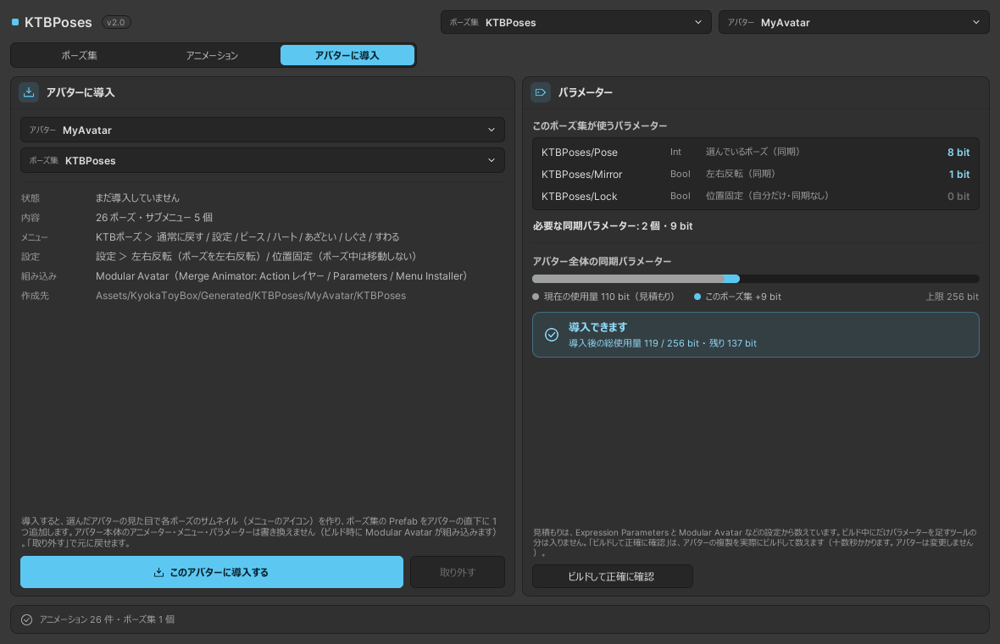

# はじめかた

同梱のポーズ集をアバターに入れて、VRChat で使うまでの流れです。

## 1. ツールを開く

**Tools → KyokaToyBox → KTBPoses** を開きます。

右上の「アバター」で、ポーズを入れるアバターを選びます。
初めて開いたときは、Hierarchy で選んでいるアバター（選んでいなければ、シーンで表示されているアバター）が選ばれています。

## 2. アバターに導入する

「アバターに導入」タブを開きます。右の「パラメーター」が **導入できます** になっていることを確かめて、**このアバターに導入する** を押します。

{ .screenshot }

アバターの直下に `KTBPoses` が追加されます。アバター本体は書き換えません。

## 3. アップロードする

いつもどおりアップロードします。アップロードのときに、Modular Avatar がメニュー・パラメーター・アニメーターを組み込みます。

## 4. VRChat でポーズをとる

Expression Menu の **KTBポーズ** を開き、カテゴリからポーズを選びます。

- 同じポーズをもう一度押すか、**通常に戻す** で元に戻ります
- 別のポーズを押すと、そのまま切り替わります

くわしくは [VRChat での使い方](in-vrchat.md) を見てください。

## 次に

- メニューを自分好みに組む：[ポーズ集を作る](pose-sets.md)
- 手持ちのポーズのアニメーションを使う：[アニメーションを追加する](library.md)
- 手が顔にめり込むなど、体型が合わないとき：[同梱ポーズを体型に合わせ直す](library.md#refit)
