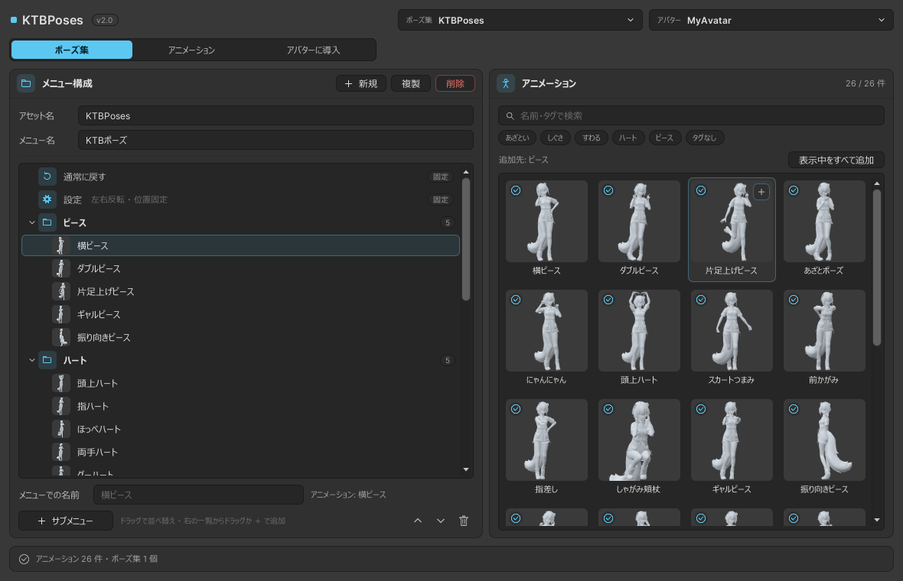

# 画面の見かた

**Tools → KyokaToyBox → KTBPoses** で開きます。

{ .screenshot }

## 上の段

| 項目 | 内容 |
|---|---|
| ポーズ集 | 編集・導入するポーズ集を選びます。「新しいポーズ集を作る」もここから |
| アバター | ポーズを入れるアバターを選びます。開いているシーンのアバターが並びます（非表示のものには「非表示」と付きます）。「Hierarchy で選択中のアバターを使う」「選択を外す」もここから |

## タブ

| タブ | すること |
|---|---|
| [ポーズ集](pose-sets.md) | メニューの構成（サブメニューとポーズ）を組みます |
| [アニメーション](library.md) | ポーズのアニメーションを追加・整理します |
| [アバターに導入](install-avatar.md) | ポーズ集をアバターに入れます。同期パラメーターの使用量も確かめられます |

## サムネイル

アバターを選ぶと、各ポーズの小さな画像を、そのアバターの姿で表示します。アバターの複製を使って描くので、シーンのアバターは動きません。非表示のアバターでも表示できます。

Humanoid でないアバターでは表示されません（下の欄にそう出ます）。

## 下の欄

操作の結果（追加した件数、エラーなど）を表示します。しばらくすると、アニメーションとポーズ集の数の表示に戻ります。

## 元に戻す

ポーズ集とライブラリの編集、アバターからの取り外しは、Unity の元に戻す（++ctrl+z++）で戻せます。

ポーズ集のアセットの作成・名前の変更・削除は戻せません。削除したポーズ集は、パソコンのゴミ箱に移動しています。
